<picture>
  <source media="(prefers-color-scheme: dark)" srcset="assets/hero-dark.svg">
  
</picture>

<p align="center">
  <a href="https://pratyushshivam.github.io/lookback/"><b>Open it</b></a> ·
  <a href="#the-scale">The scale</a> ·
  <a href="#how-it-stays-precise">Precision</a> ·
  <a href="#how-it-stays-light">Weight</a> ·
  <a href="#run-it">Run it</a> ·
  <a href="https://www.pratyushshivam.com/">pratyushshivam.com</a>
</p>

# Lookback

**The universe at true scale, in a browser tab.** You start a few thousand kilometres above Earth. Scroll, and the camera pulls back in one unbroken motion: past the Moon, the planets, the Kuiper belt, the nearest stars, the Milky Way, the nearest galaxies, and out to the edge of the observable universe, 46 billion light-years away. That is twenty orders of magnitude without a cut or a loading screen.

Every size and every distance is real. The planets are where they are right now. The stars and galaxies are real catalogues, not decoration. And the whole journey downloads in under 3 MB.

**Open:** [pratyushshivam.github.io/lookback](https://pratyushshivam.github.io/lookback/)

<a href="https://pratyushshivam.github.io/lookback/">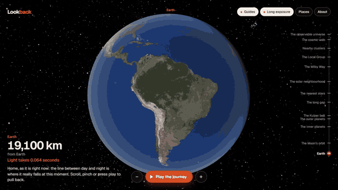</a>

<p align="center"><sub>The guided journey, eight times faster than it plays. <a href="assets/journey.mp4">Full-quality video</a>.</sub></p>

<table>
<tr>
<td width="50%" valign="top"><br><sub><b>Home, right now.</b> The line between day and night is where it really falls at this moment.</sub></td>
<td width="50%" valign="top">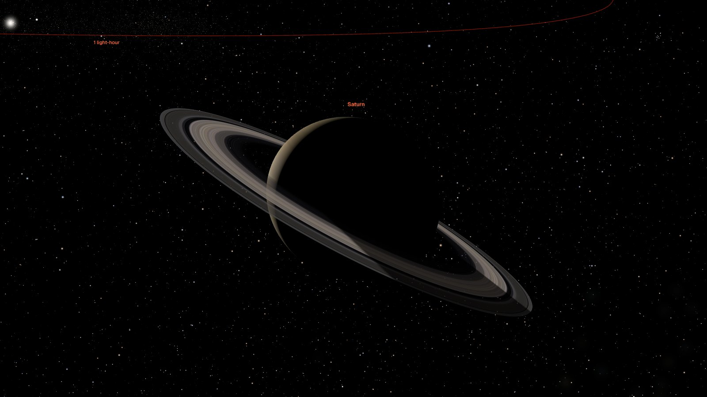<br><sub><b>Saturn from behind.</b> True flattening, and the planet's shadow falls across the rings.</sub></td>
</tr>
<tr>
<td width="50%" valign="top">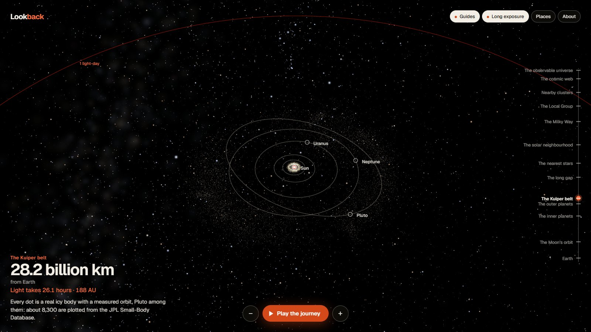<br><sub><b>The Kuiper belt.</b> 8,301 real bodies, each on its own measured orbit.</sub></td>
<td width="50%" valign="top"><br><sub><b>942 light-years out.</b> 109,400 real stars. The constellations have dissolved.</sub></td>
</tr>
<tr>
<td width="50%" valign="top">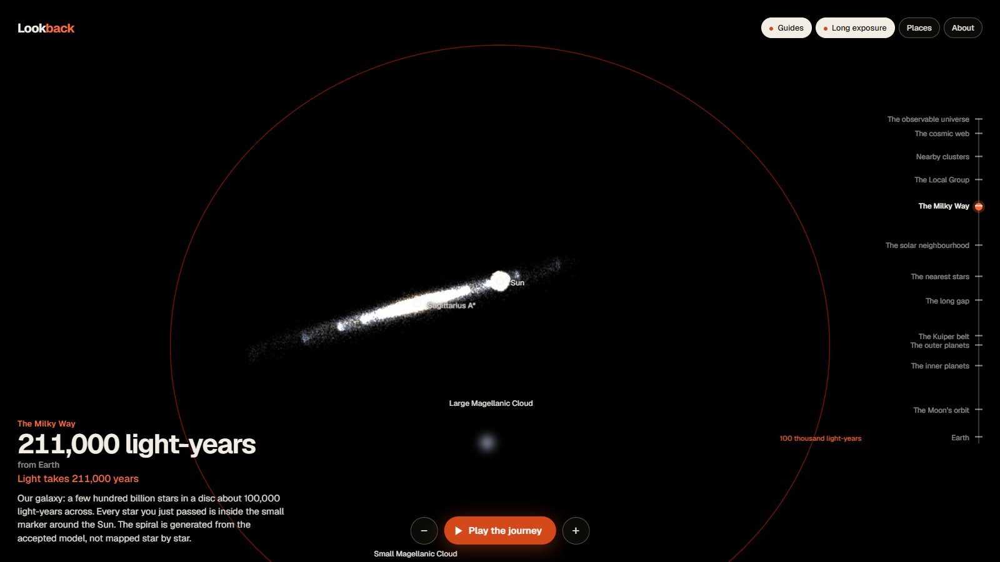<br><sub><b>The Milky Way.</b> Every star you passed is inside the small marker at the Sun.</sub></td>
<td width="50%" valign="top">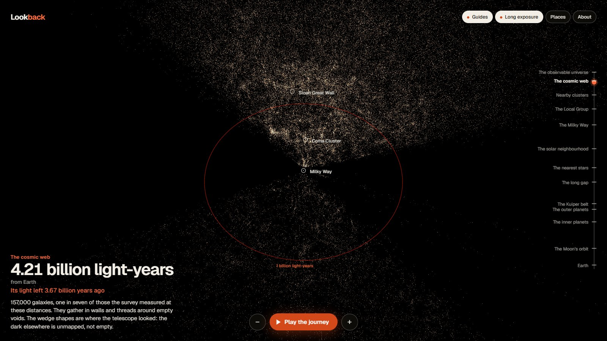<br><sub><b>The cosmic web.</b> 156,940 galaxies from the Sloan survey, in walls and threads around voids.</sub></td>
</tr>
</table>

<table>
<tr>
<td width="25%" valign="top"></td>
<td width="25%" valign="top">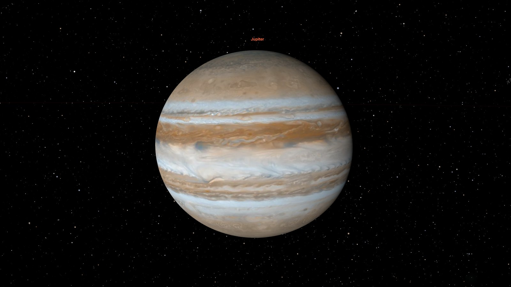</td>
<td width="25%" valign="top">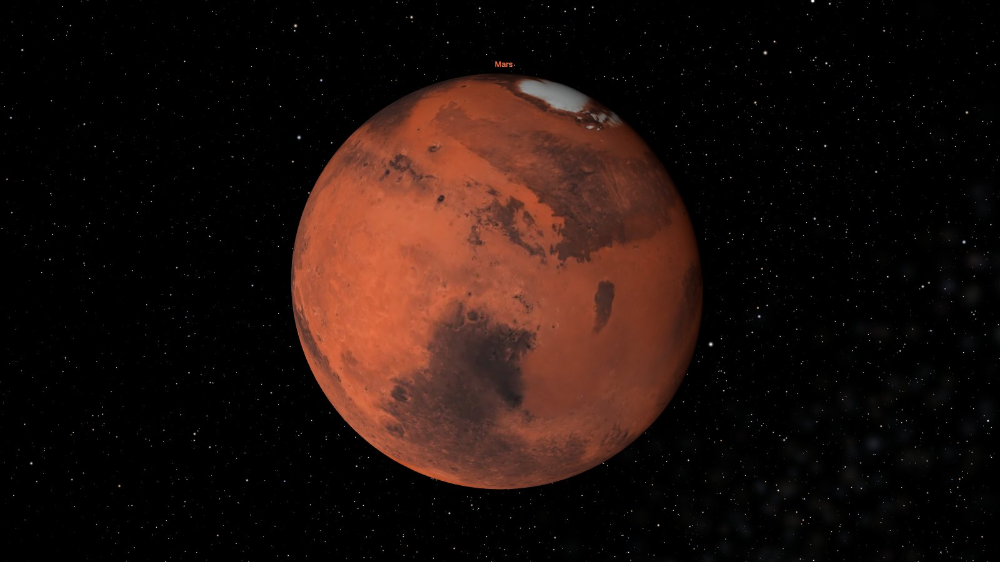</td>
<td width="25%" valign="top"></td>
</tr>
<tr>
<td width="25%" valign="top">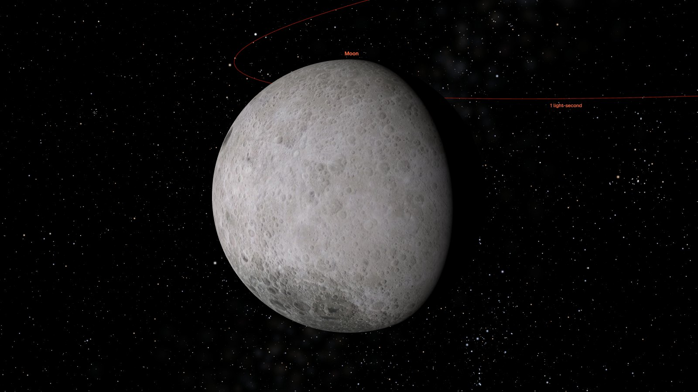</td>
<td width="25%" valign="top">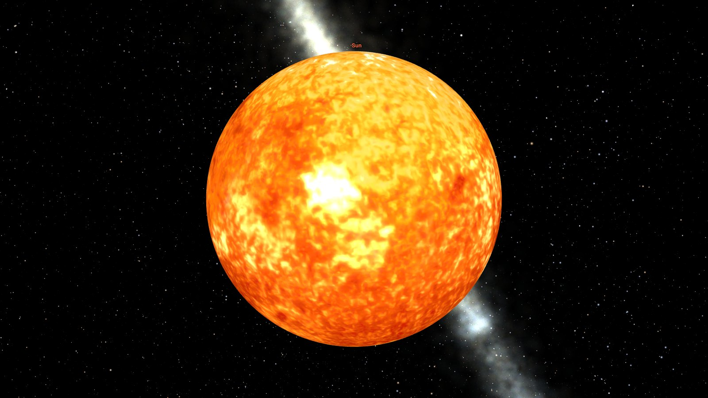</td>
<td width="25%" valign="top">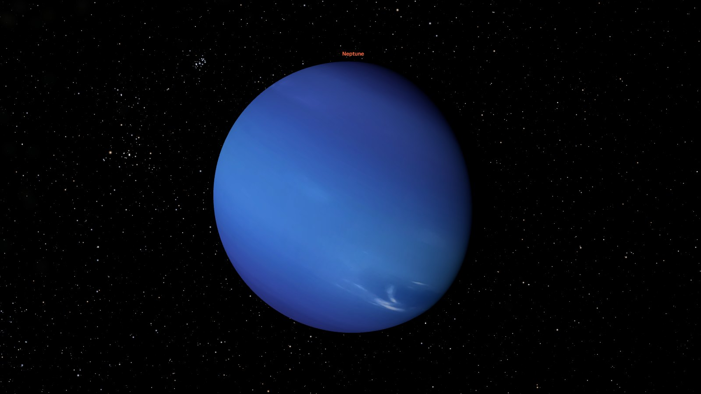</td>
<td width="25%" valign="top">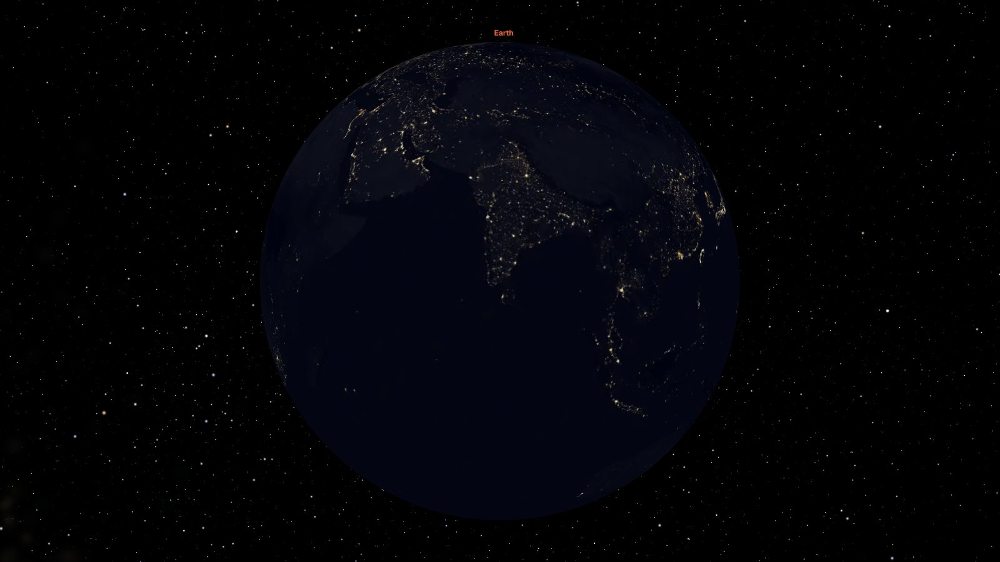</td>
</tr>
</table>

<table>
<tr>
<td width="33%" valign="top">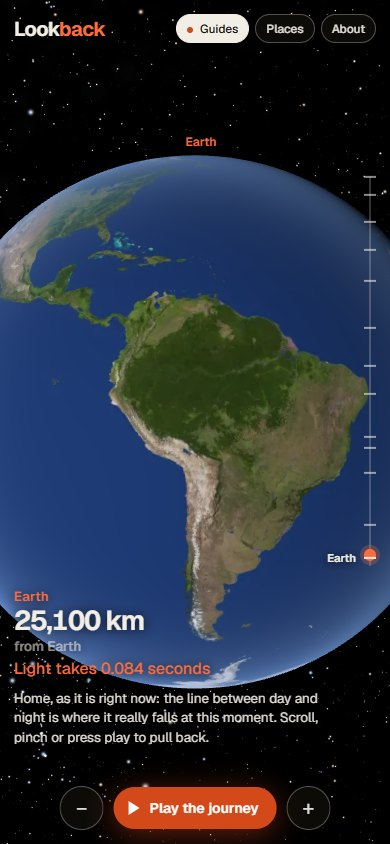</td>
<td width="33%" valign="top">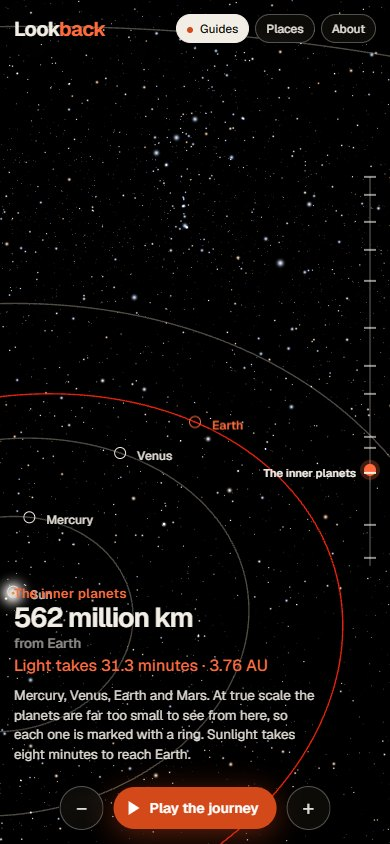</td>
<td width="33%" valign="top">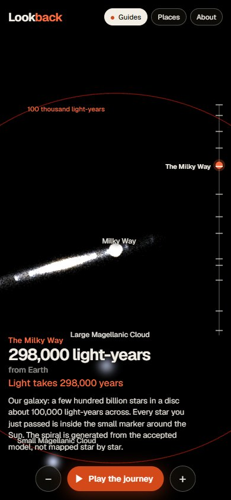</td>
</tr>
</table>

<p align="center"><sub>The same on a phone: pinch to pull back, drag to look around, tap anything. More in <a href="assets/screens">assets/screens</a>.</sub></p>

| | |
| :-- | :-- |
| **The journey** | 19,000 km above Earth to 46.1 billion light-years, in one continuous motion |
| **What is in it** | 11 solar system bodies, 16,301 asteroids and Kuiper belt objects, 109,400 stars, 156,940 galaxies |
| **Weight** | 1.7 MB before Earth is on screen, 2.9 MB for the entire journey |
| **Controls** | Mouse, touch and keyboard. A guided mode that plays itself. Respects reduced motion |
| **Stack** | TypeScript, three.js on WebGL2, Vite. Static files only. A pure TypeScript core with tests |

## The scale

<picture>
  <source media="(prefers-color-scheme: dark)" srcset="assets/scale-dark.svg">
  
</picture>

Space is almost entirely distance. If Earth were the full stop at the end of this sentence, the Moon would be a centimetre away, the Sun three and a half metres, and the nearest star a thousand kilometres. No linear picture can hold that, so Lookback moves in powers of ten: one scroll notch multiplies your distance by the same factor whether that means 3,000 km or 3,000 light-years.

The readout always says how far you are from Earth and how long light takes to cross that gap. Looking out is looking back in time, which is where the name comes from. Past the Local Group the two numbers come apart, because space itself stretches while the light is travelling: the edge is 46.1 billion light-years away today, and its light set out 13.8 billion years ago.

## What you can do

1. **Scroll or pinch** to pull back. **Drag** to look around.
2. **Click or tap anything** to fly to it and read two or three plain sentences about it, with the source.
3. **Play the journey** runs the whole pull-back on its own in 94 seconds, for watching or recording.
4. **The rail** on the right jumps between thirteen scales. Drag along it to scrub.
5. **Guides** and **Long exposure** switch the aids off, so you can see exactly what is real.

Keyboard: `↑` `↓` pull back and move in, `←` `→` look around, `Space` plays or pauses, `G` guides, `E` exposure, `H` home, `Esc` closes a panel.

Add `?stats` to the address for live frame rate, memory and network figures, or `?weak` to force the light mode that phones get.

## What is real, and what is an aid

| | What you see | Where it comes from |
| :-- | :-- | :-- |
| **Planets, Moon, Pluto** | Where they are at the moment you open the page. Earth's day and night sides are the real ones | NASA JPL orbital elements |
| **Stars** | 109,400 at their measured positions, colours and brightness. Brightness follows the inverse-square law from wherever the camera is | HYG catalogue 4.1 |
| **Small bodies** | 8,301 Kuiper belt objects and 8,000 asteroids, each on its own orbit | JPL Small-Body Database |
| **Galaxies** | 156,940, placed by measured redshift | Sloan Digital Sky Survey DR17 |
| **Sizes** | True radii, including the flattening of Jupiter and Saturn | NASA Planetary Fact Sheets |

**The aids, each of which can be switched off.** *Guides* are the orbit lines, names, light-distance rings around Earth and the small ring that marks anything too small to see. At true scale the planets vanish almost at once, and the rings are how you find them. *Long exposure* raises the brightness limit as you travel, as a camera would with a longer exposure. Turn it off and you get the unaided eye, for which nearly everything beyond a few light-years is black. That is also true.

**What is not measured data.** Nobody has mapped the whole Milky Way, so its shape is generated in your browser from the accepted model (a bar, four arms, the Sun 26,700 light-years from the centre): the proportions are real, the individual points are not stars. The soft glows of named galaxies mark position and rough size, not shape. Pluto is a plain sphere. The app says all of this in its About panel, and [CREDITS.md](CREDITS.md) lists every source and licence.

## How it stays precise

A graphics card works in 32-bit floats: about seven significant digits. The radius of the Earth and the radius of the observable universe differ by twenty. Put a planet at its real coordinates in a float and it shakes itself to pieces. The fix is plain TypeScript in [`src/core`](src/core), with no rendering code in it, and it is covered by tests.

| Part | What Lookback does | Where |
| :-- | :-- | :-- |
| **Frames** | Every object stores its position relative to its parent (Moon to Earth, Earth to Sun) in float64 metres. The offset between two objects is summed through their nearest common ancestor, so nearby things never subtract two enormous numbers | [`frames.ts`](src/core/frames.ts) |
| **Camera** | The camera has no world position. It is a small offset from whatever it looks at. Everything is expressed relative to it in float64, divided by a per-object unit, and only then narrowed to float32, so precision is best exactly where you are looking | [`frames.ts`](src/core/frames.ts) |
| **Scale frames** | Stars live in parsecs, galaxies in megaparsecs, orbits in astronomical units. The camera's position in each frame reaches the shader as a high part and a low part, which makes the per-vertex subtraction exact near the camera | [`layers.ts`](src/render/layers.ts) |
| **Depth** | No depth range covers 1,000 km to 10²⁶ m. Stars, galaxies and lines never touch the depth buffer. Solid bodies are drawn far to near, each with a range fitted round its own sphere. Bodies in space do not intersect, so nothing can flicker | [`depth.ts`](src/core/depth.ts) |
| **Zoom** | Distance moves in log space, and the guided journey is a monotone spline through the landmarks: continuous speed, no stops, no cuts | [`zoom.ts`](src/core/zoom.ts) |
| **Orbits** | Kepler's equation for the planets and small bodies, a series for the Moon, IAU rotation models for each body's spin | [`kepler.ts`](src/core/kepler.ts) |
| **Cosmology** | Distance today and light-travel time from redshift, in a flat universe with the Planck 2018 values | [`cosmology.ts`](src/core/cosmology.ts) |

One test shows the naive approach losing a whole kilometre at Earth's distance from the Sun, where this path keeps it to a micrometre.

**Checked against the real sky.** The tests reproduce the Jupiter and Saturn conjunction of 21 December 2020, the close approach of Mars in October 2020, the solar eclipse of 8 April 2024 and the lunar eclipse of 14 March 2025.

## How it stays light

Measured on the production build, in Chromium at 1280 × 720 and device pixel ratio 1, on a laptop with an NVIDIA RTX 4060:

| | Measured |
| :-- | :-- |
| **Downloaded before Earth is on screen and usable** | 1.73 MB |
| **Downloaded over the whole journey, Earth to the edge** | 2.95 MB |
| **Every asset in the build, if all were fetched** | 5.7 MB |
| **JavaScript** | 595 kB, 156 kB gzipped |
| **Frame rate through the guided journey** | 60 fps (16.7 ms), capped by the display |
| **JavaScript heap, start to end** | 15 to 29 MB |
| **Textures on the graphics card at once** | 1 to 4 |
| **Draw calls per frame** | 3 to 15 |
| **Frames drawn while nothing moves** | 0 |

**Not yet measured:** a real mid-range phone and a laptop with integrated graphics. The light mode exists for them and the layout is checked at phone size, but the frame rate on that hardware is still to be confirmed.

- **Draws on demand.** The loop stops asking for frames the moment nothing is moving, so an idle tab costs nothing.
- **Eight bytes per star.** Direction in 2 × 16 bits (octahedral), distance in 16 bits on a log scale, brightness and colour in 8 bits each. 109,400 stars are 875 kB, with errors far below the catalogue's own. See [`starcodec.ts`](src/core/starcodec.ts).
- **Brightest first.** The star file is sorted by brightness from Earth and split in two, so a phone fetches the first 30,000 and still gets the familiar sky.
- **Stepped textures.** A planet is a flat mean colour while it is a dot (which is exact at that size), then 512, 2,048 and, for Earth, 4,096 pixels as it grows, decoded off the main thread. When it shrinks again the texture is released.
- **Loaded and released by scale.** Asteroids arrive as you leave Earth and are dropped past the Kuiper belt. Galaxies arrive once the Milky Way is small and are dropped on the way back in.
- **The galaxy is generated, not downloaded.** 64,000 points from a seeded generator, in a few milliseconds.
- **Weak devices** get fewer stars and galaxies and a lower resolution cap. Any device that falls behind gives up resolution before it gives up smoothness.

### Sources

- Stars: [HYG database 4.1](https://www.astronexus.com/projects/hyg), David Nash, CC BY-SA 4.0
- Galaxies: [Sloan Digital Sky Survey, Data Release 17](https://www.sdss.org/), public domain
- Planet positions: [NASA JPL, Approximate Positions of the Planets](https://ssd.jpl.nasa.gov/planets/approx_pos.html). Small bodies: [JPL Small-Body Database](https://ssd-api.jpl.nasa.gov/doc/sbdb_query.html)
- Planet maps: [Solar System Scope](https://www.solarsystemscope.com/textures/), CC BY 4.0, based on NASA imagery
- Sizes: [NASA Planetary Fact Sheets](https://nssdc.gsfc.nasa.gov/planetary/factsheet/). Rotation: IAU Working Group on Cartographic Coordinates and Rotational Elements, 2015 report
- Cosmology: [Planck 2018 results VI](https://doi.org/10.1051/0004-6361/201833910). Distance to the galactic centre: [GRAVITY Collaboration 2019](https://doi.org/10.1051/0004-6361/201935656)

The full list, with what was changed and what is illustrative, is in [CREDITS.md](CREDITS.md).

## Run it

Needs Node.js 20 or newer.

```bash
npm install
```

```bash
npm run dev
```

Then open the address it prints.

| Command | What it does |
| :-- | :-- |
| `npm run dev` | Development server |
| `npm run build` | Static site in `dist/`, ready for any static host, at any path |
| `npm test` | Unit tests for the frames, depth, orbits, cosmology, codec and zoom |
| `npm run typecheck` | TypeScript, no emit |
| `npm run data` | Rebuilds the star, galaxy and small-body binaries from the raw catalogues |
| `npm run textures` | Rebuilds the stepped planet textures |
| `npm run readme` | Rebuilds the graphics on this page |

## How it is put together

```
src/core     the maths: frames, depth, orbits, cosmology, catalogue codec, zoom. Pure, tested.
src/data     orbital elements, bodies, deep-sky objects, the chapters of the journey
src/render   three.js layers (points and lines) and bodies (spheres, rings, stepped textures)
src/engine   the camera, the frame loop, loading and releasing by scale
src/main     the interface: readout, rail, labels, input
scripts      data, texture and graphics generators
```

The star field in the title graphic is not an illustration. It is the sky around Orion as seen from Earth, plotted from the same catalogue file the page loads.

## Licence

[MIT](LICENSE) for the code. Data and imagery keep their own licences, listed in [CREDITS.md](CREDITS.md); the star files derived from the HYG database are CC BY-SA 4.0. The Geist typeface is used under the SIL Open Font License.

<p align="center"><sub>Built by <a href="https://www.pratyushshivam.com/">Pratyush Shivam</a>. The graphics on this page are hand-built SVG with CSS animation, generated from the same data and constants the app runs on. They follow your light or dark theme.</sub></p>
