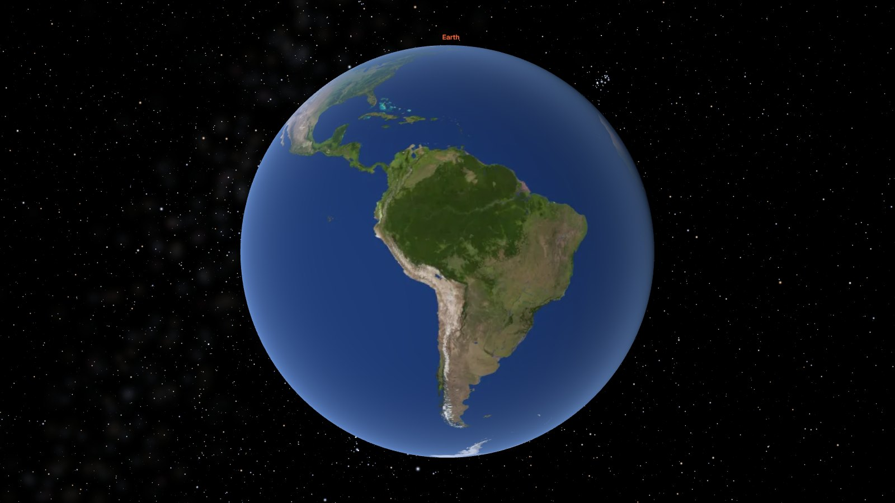
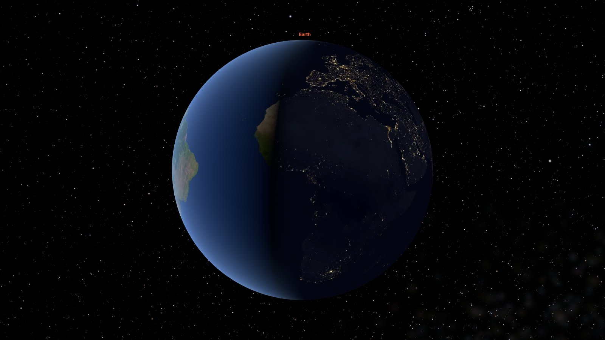
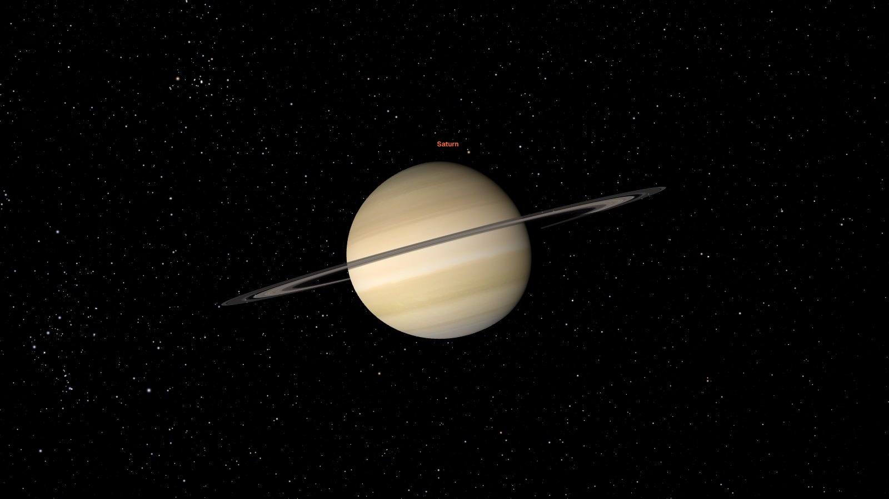
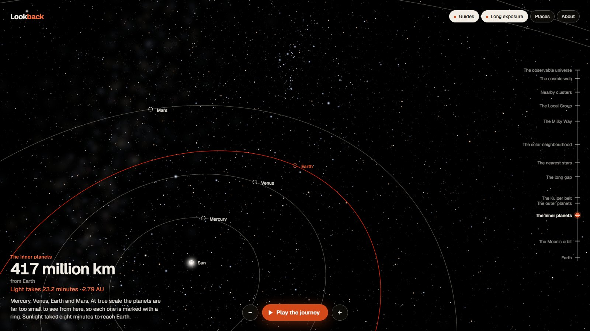
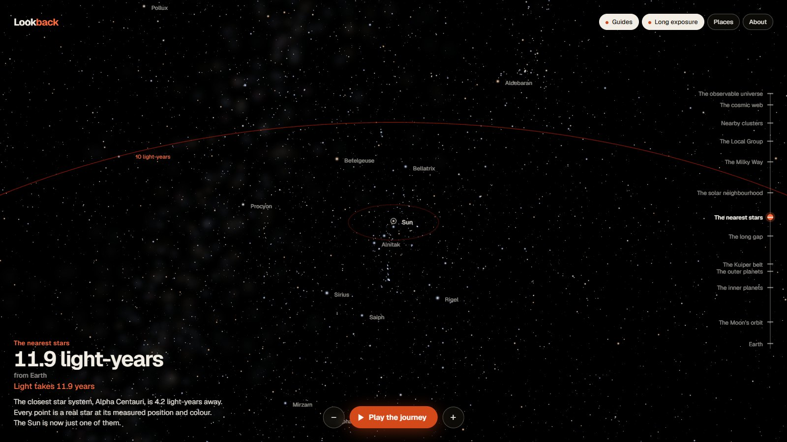
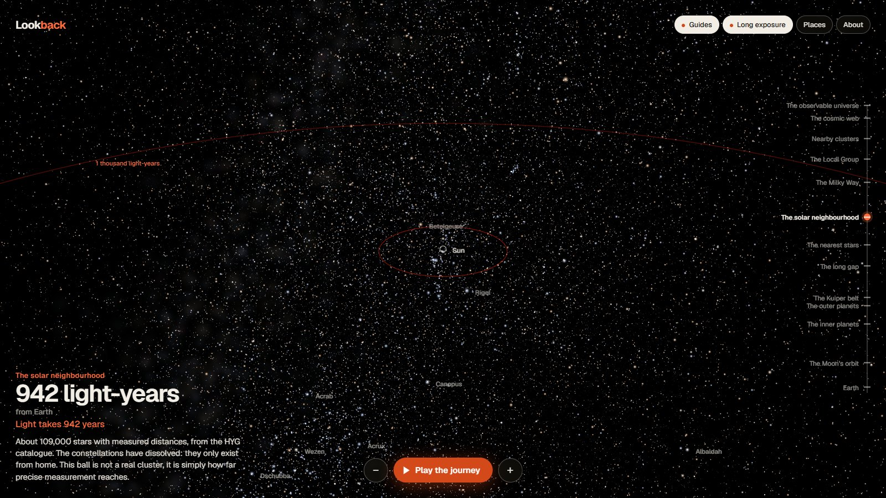

# Lookback

**The universe at true scale, in a browser tab.** Start above Earth and pull back, in one unbroken motion, past the Moon, the planets, 109,400 real stars and 157,000 real galaxies, to the edge of the observable universe: 46 billion light-years away, 20 orders of magnitude from where you started.

Every size and every distance is real. The whole journey downloads under 3 MB.


[Full-quality video (MP4, 19 seconds)](docs/journey.mp4)

| | | |
| --- | --- | --- |
|  |  |  |
|  |  |  |
|  |  |  |
|  |  |  |

More in [`docs/`](docs).

## Run it

```bash
npm install
npm run dev
```

Then open the address it prints. `npm test` runs the unit tests, `npm run build` writes a static site to `dist/` that any file host can serve (no server code, relative paths, works from a sub-folder).

## What you can do

- **Scroll or pinch** to pull back; **drag** to look around; **click or tap** anything to fly to it and read about it.
- **Play the journey** runs the whole pull-back on its own in 94 seconds, for watching or recording.
- The **rail** on the right jumps between thirteen scales, or drag along it to scrub.
- **Places** lists planets, stars and galaxies to fly to.
- **Guides** and **Long exposure** switch the aids off (see below).
- Keys: `↑` `↓` pull back and move in, `←` `→` look around, `Space` play or pause, `G` guides, `E` exposure, `H` home, `Esc` close.
- Add `?stats` to the address for live frame rate, memory and network numbers; `?weak` forces the light mode used on phones.

## What is real, and what is an aid

Real, from public data ([CREDITS.md](CREDITS.md) has every source and licence):

- Planet, Moon and Pluto positions for the moment you open the page, from NASA JPL orbital elements. Earth's day and night sides are where they really are right now.
- 109,400 stars from the HYG catalogue at their measured positions, colours and brightness. Brightness follows the inverse-square law from wherever the camera is, so the constellations distort and dissolve as you leave.
- 8,301 Kuiper belt objects and 8,000 asteroids from the JPL Small-Body Database, each on its own orbit.
- 156,940 galaxies from the Sloan Digital Sky Survey, placed by their measured redshift.
- Sizes, including the flattening of Jupiter and Saturn.

Aids, each of which can be switched off:

- **Guides**: orbit lines, names, light-distance rings around Earth, and a small ring marking anything too small to see. At true scale the planets vanish almost at once; the rings are how you find them.
- **Long exposure**: the brightness limit rises as you travel, as a camera's would with a longer exposure. Off means the unaided eye, and then nearly everything beyond a few light-years is black. That is also true.

Not measured data, and labelled as such in the app: the shape of the Milky Way (generated from the accepted model: bar, four arms, Sun 26,700 light-years from the centre), the soft glows that mark named galaxies, and Pluto's surface.

Beyond the Local Group "how far" and "how long ago" stop being the same number, because space expands while light travels. The readout then shows the distance today and, separately, how long ago the light left, using the Planck 2018 cosmology. At the edge those are 46.1 billion light-years and 13.8 billion years.

## How it stays precise

A GPU works in 32-bit floats: about seven significant digits. Earth's radius and the size of the observable universe differ by twenty. Put a planet at its real coordinates in a float and it shakes itself to pieces. The fix lives in [`src/core/`](src/core), as pure TypeScript with no rendering imports, and is covered by tests.

1. **A tree of frames, in float64.** Every object stores its position relative to its parent (the Moon relative to Earth, Earth relative to the Sun), in metres. The offset between any two objects is summed through their nearest common ancestor, so two nearby things never subtract two enormous numbers. ([`frames.ts`](src/core/frames.ts))
2. **The camera has no world position.** It is a small offset from whatever it is looking at. Each frame, everything is expressed relative to the camera in float64, divided by a per-object unit, and only then narrowed to float32. The camera sits at the origin of what the GPU sees, so precision is always best exactly where you are looking. A test shows the naive approach losing a whole kilometre at Earth's distance from the Sun while this path keeps it to a micrometre.
3. **Nested scale frames for point clouds.** Stars are stored in parsecs, galaxies in megaparsecs, orbits in astronomical units. The camera's position inside each frame is passed to the shader as two floats (a high part and a low part), which makes the per-vertex subtraction exact near the camera: no jitter when you fly up to a star 4 light-years from the origin.
4. **Depth without a depth range.** No single near/far pair covers 1,000 km to 10^26 m, and a logarithmic depth buffer costs work on every pixel. Stars, galaxies and lines never touch the depth buffer. Solid bodies are drawn far to near, each with a depth range fitted tightly round its own sphere and the buffer cleared in between. Bodies in space do not intersect, so the order is exact and nothing can flicker. ([`depth.ts`](src/core/depth.ts))
5. **Zoom in log space.** One scroll notch multiplies the distance by the same factor whether that is 3,000 km or 3,000 light-years, and the guided journey is a monotone spline through the landmarks: continuous speed, no stops, no cuts. ([`zoom.ts`](src/core/zoom.ts))

The orbital maths is checked against the real sky: the tests reproduce the Jupiter–Saturn conjunction of 21 December 2020, the close approach of Mars in October 2020, the solar eclipse of 8 April 2024 and the lunar eclipse of 14 March 2025.

## How it stays light

Measured on the production build (`npm run build`, served locally), Chromium, 1280×720, device pixel ratio 1, NVIDIA RTX 4060 laptop GPU:

| | Measured |
| --- | --- |
| Downloaded before Earth is on screen and interactive | 1.73 MB |
| Downloaded over the entire journey, Earth to the edge | 2.95 MB |
| Everything in `dist/`, if every asset were fetched | 5.7 MB |
| JavaScript | 595 kB (156 kB gzipped) |
| Frame rate through the guided journey | 60 fps (16.7 ms), capped by the display |
| JavaScript heap, start to end of the journey | 15 to 29 MB |
| GPU textures alive at once | 1 to 4 |
| Draw calls per frame | 3 to 15 |
| Frames drawn while nothing moves | 0 |

Not yet measured: a real mid-range phone and an integrated-graphics laptop. The light mode exists for them and the layout is verified at phone size, but the frame rate on that hardware is still to be confirmed.

How:

- **Draw on demand.** The loop stops requesting frames the moment nothing is moving, so an idle tab uses no GPU.
- **Compact catalogues.** Each star or galaxy is 8 bytes: direction (octahedral, 2×16 bits), distance (16 bits, log scale), magnitude and colour (8 bits each). 109,400 stars are 875 kB; errors are under 0.01° and 0.02 percent, far below the catalogue's own. ([`starcodec.ts`](src/core/starcodec.ts))
- **Brightest first.** The star file is sorted by brightness from Earth and split in two, so phones fetch only the first 30,000 and still get the familiar sky.
- **Stepped textures.** Planets are a flat mean colour while they are dots (exact at that size), then 512 px, 2,048 px and, for Earth, 4,096 px as they grow, decoded off the main thread. When a planet shrinks again its texture is released.
- **Loaded and released by scale.** Asteroids load when you leave Earth and are dropped past the Kuiper belt; galaxies load only once the Milky Way is small and are dropped on the way back in.
- **The galaxy is generated, not downloaded:** 64,000 points from a seeded generator in a few milliseconds.
- **Weak devices** get fewer stars, galaxies and particles, a lower pixel-ratio cap and no multisampling; any device that drops below about 40 fps steps its resolution down rather than its smoothness.
- **Reduced motion** is respected: flights become cuts and the guided journey becomes a sequence of still stops.

## Project layout

```
src/core/      pure maths, no rendering: frames, depth, orbits, cosmology, codec, zoom   (tested)
src/data/      orbital elements, bodies, deep-sky objects, the journey's chapters
src/render/    three.js layers (points, lines) and bodies (spheres, rings, textures)
src/engine.ts  camera, frame loop, loading by scale
src/main.ts    interface: readout, rail, labels, input
scripts/       build the binaries and texture tiers from the raw public data
tests/         51 unit tests
```

Built with TypeScript, three.js (WebGL2) and Vite. No backend, no tracking, no runtime dependencies beyond three.js and the Geist typeface.

## Licence

Code: MIT. Data and imagery keep their own licences, listed in [CREDITS.md](CREDITS.md); the star files derived from the HYG database are CC BY-SA 4.0.

Made by [Pratyush Shivam](https://pratyushshivam.com).
